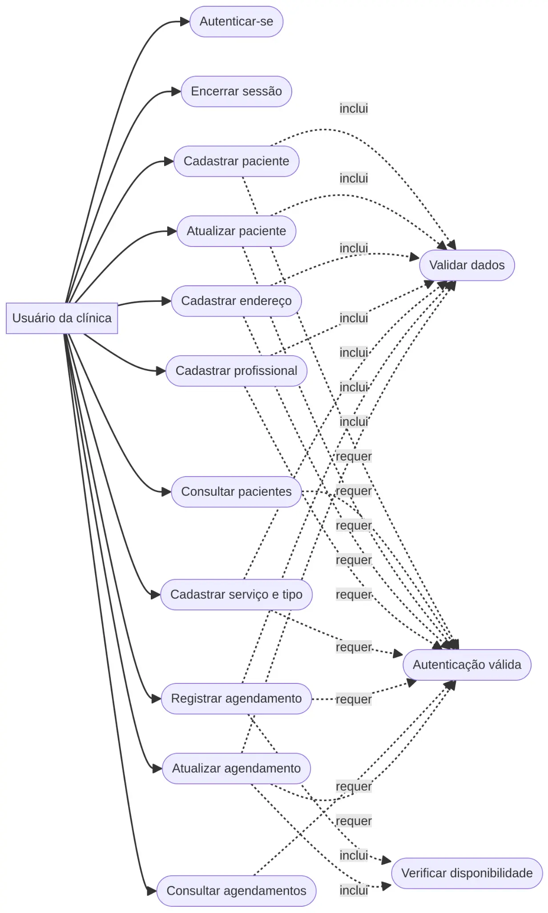
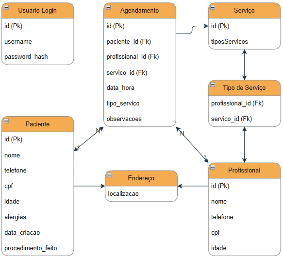
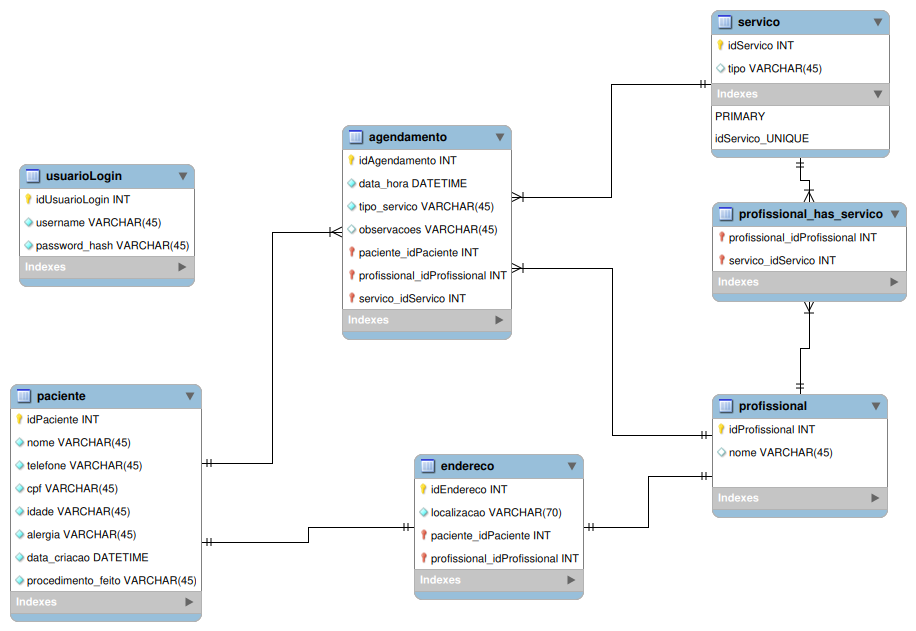

# Desenvolvimento de uma aplicação web MVC para gestão administrativa de uma clínica de estética

**Marcio Andrez da Silva Júnior; Roberta Vanessa Rojo Parcianello**  
Instituto Federal do Paraná — Campus Cascavel (IFPR)  
m20233005680@gmail.com; roberta.parcianello@ifpr.edu.br

## Abstract

This paper reports the development of a server-rendered web application to support administrative activities in an aesthetic clinic. Its scope covers patient records, professional and service management, and appointment scheduling. Requirements were gathered in an informal conversation followed by an interview with the clinic owner. Based on these requirements, the author prepared the entity–relationship and class diagrams; the advisor recommended adding professional management to accommodate possible future expansion. The application was reorganized as an MVC system using Java, Spring Boot, Spring MVC, Spring Data JPA, Spring Security, and Thymeleaf. It uses form-based authentication with server-side sessions and implements rules for professional-service eligibility and appointment conflicts. H2 is the default local database, while MySQL is available as an alternative profile. During development, the author performed a small number of manual checks and corrected issues as they were observed. The current automated suite passed six tests: four MVC integration scenarios and two CPF-validation tests. These results are limited to the tested cases and do not establish complete requirements coverage. Usability assessment with participants, clinic acceptance, and MySQL-profile validation have not been completed. The application is therefore presented as a functional academic increment, not as a product validated for operational use.

**Keywords:** aesthetic clinic; server-rendered MVC; appointment management; web application; software development.

## Resumo

Este trabalho relata o desenvolvimento de uma aplicação web com páginas renderizadas no servidor para apoiar atividades administrativas de uma clínica de estética. O escopo abrange cadastro de pacientes, manutenção de profissionais e serviços e gerenciamento de agendamentos. Os requisitos foram levantados em uma conversa informal, seguida de entrevista com a proprietária da clínica. Com base nessas informações, o autor elaborou o diagrama entidade-relacionamento e o diagrama de classes; a orientadora recomendou incluir o cadastro de profissionais para permitir uma possível expansão futura. A aplicação foi reorganizada como um sistema MVC, utilizando Java, Spring Boot, Spring MVC, Spring Data JPA, Spring Security e Thymeleaf. O sistema utiliza autenticação por formulário e sessão e implementa regras para verificar a habilitação do profissional para o serviço e conflitos de horário. O H2 é o banco local padrão, e o MySQL está disponível como perfil alternativo. Durante o desenvolvimento, o autor realizou poucos testes manuais e corrigiu problemas conforme os observava. A suíte automatizada atual foi aprovada com seis testes: quatro cenários de integração MVC e dois testes de validação de CPF. Esses resultados se limitam aos casos testados e não comprovam cobertura integral dos requisitos. A avaliação de usabilidade com participantes, o aceite da clínica e a validação do perfil MySQL ainda não foram realizados. Portanto, a aplicação é apresentada como um incremento acadêmico funcional, e não como produto validado para operação.

**Palavras-chave:** clínica de estética; MVC renderizado no servidor; gestão de agendamentos; aplicação web; desenvolvimento de software.

## 1. Introdução

A gestão administrativa de uma clínica envolve informações sobre pacientes, profissionais, serviços e horários de atendimento. No contexto que motivou este trabalho, a organização dessas informações foi identificada como uma necessidade a ser discutida com a responsável pela clínica. O levantamento realizado, porém, não mediu a frequência de falhas em registros existentes nem quantificou o tempo gasto em tarefas administrativas. Por isso, este estudo não parte da premissa de que a informatização, por si só, reduz erros ou custos.

O trabalho apresenta uma aplicação web destinada a apoiar atividades administrativas de uma clínica específica. As funções implementadas incluem cadastro e consulta de pacientes, manutenção de profissionais e serviços e gerenciamento de agendamentos. O registro de um horário relaciona paciente, profissional, serviço, data e hora; as regras verificam se o profissional está associado ao serviço e se existe conflito de agenda.

O sistema não substitui prontuário clínico, não orienta procedimentos estéticos, não realiza diagnósticos e não gerencia pagamentos. A versão descrita também não oferece operação para várias clínicas. Diante desse recorte, a questão de pesquisa é: **quais funcionalidades e regras de negócio podem ser implementadas em uma aplicação web MVC para apoiar o cadastro e os agendamentos de uma clínica de estética, e quais evidências permitem verificar parte desse comportamento?**

O objetivo geral é desenvolver uma aplicação web MVC para apoiar a gestão administrativa da clínica e verificar parte das regras implementadas por meio de testes automatizados. A avaliação de usabilidade com participantes e a validação de aceite pela clínica são tratadas como etapas futuras, não como resultados deste trabalho.

### 1.1 Justificativa e delimitação

A centralização de cadastros e horários pode tornar as informações acessíveis em uma única aplicação. Entretanto, só uma avaliação em uso permitiria determinar se essa organização atende às necessidades da equipe e se produz benefícios como redução de retrabalho ou de erros. Como não houve comparação entre a rotina anterior e a utilização do sistema, tais benefícios não são afirmados.

O escopo foi delimitado às funções administrativas implementadas e às regras que podem ser verificadas no código e nos testes existentes. Permanecem pendentes decisões de requisitos que dependem de confirmação da clínica, como a finalidade de certos dados cadastrais, a duração efetiva dos serviços e a política completa de disponibilidade. Este artigo também não declara conformidade legal integral nem implantação em ambiente de produção.

## 2. Objetivos

### 2.1 Objetivo geral

Desenvolver uma aplicação web MVC para apoiar a gestão administrativa de uma clínica de estética, com foco em pacientes, profissionais, serviços e agendamentos, e verificar parte das regras por testes automatizados.

### 2.2 Objetivos específicos

- Organizar os requisitos levantados e os modelos de dados e classes elaborados para o sistema.
- Implementar autenticação para restringir o acesso às funções administrativas.
- Permitir o cadastro e a consulta de pacientes.
- Manter registros de profissionais e serviços e suas associações.
- Registrar e consultar agendamentos, verificando a associação profissional-serviço e conflitos de horário.
- Converter a interface para páginas MVC renderizadas no servidor e documentar as verificações automatizadas realizadas.
- Empregar as heurísticas de Nielsen como referência para decisões de interface, distinguindo esses ajustes de uma avaliação formal de usabilidade.

## 3. Fundamentação teórica

### 3.1 Aplicações web e organização MVC

Uma aplicação web pode processar as requisições no servidor e devolver ao navegador páginas HTML já renderizadas. No padrão Model–View–Controller (MVC), o modelo representa os dados e as regras associadas, a visão organiza a apresentação e o controlador recebe as interações e coordena a resposta. O Spring Web MVC oferece recursos para esse tipo de aplicação no ecossistema Spring, incluindo controladores e tecnologias de visão (Spring, s.d.).

Neste projeto, os controladores recebem requisições de navegação e submissões de formulários. Os serviços concentram regras de negócio, enquanto entidades e repositórios apoiam a representação e a persistência dos dados. As páginas Thymeleaf produzem a interface HTML no servidor. Essa organização descreve a implementação adotada; por si só, não comprova qualidade de manutenção, segurança ou adequação à produção.

### 3.2 Persistência de dados

A aplicação utiliza entidades relacionais para representar pacientes, profissionais, serviços e agendamentos. O projeto configura o H2 como banco local padrão e disponibiliza um perfil alternativo para MySQL. O manual oficial do MySQL documenta a instalação, administração, linguagem SQL e recursos do sistema gerenciador (Oracle, 2026).

A suíte automatizada deste trabalho executa com H2 em memória. Assim, seus resultados verificam comportamentos da aplicação no ambiente de teste, mas não demonstram a conexão, a persistência ou a implantação com MySQL. A validação desse perfil deve ser realizada separadamente, pois o uso de bancos diferentes não permite presumir que a configuração e o comportamento sejam idênticos.

### 3.3 Usabilidade e heurísticas de Nielsen

As dez heurísticas de Nielsen são princípios gerais para orientar a análise de interfaces: visibilidade do estado do sistema; correspondência entre sistema e mundo real; controle e liberdade; consistência e padrões; prevenção de erros; reconhecimento em vez de memorização; flexibilidade e eficiência; design estético e minimalista; reconhecimento, diagnóstico e recuperação de erros; e ajuda e documentação (Nielsen, 1994, rev. 2024). Elas ajudam a identificar problemas potenciais, mas não constituem, isoladamente, uma medida quantitativa de usabilidade.

Uma avaliação heurística exige que avaliadores analisem a interface segundo critérios definidos e registrem problemas observados. A Nielsen Norman Group recomenda que a avaliação seja delimitada por tarefas e escopo e esclarece que ela complementa, mas não substitui, a pesquisa com usuários (Moran; Gordon, 2023). Neste trabalho, as heurísticas foram usadas como referência para ajustes pontuais da interface. Não foi conduzida uma avaliação formal com participantes, registro de achados e classificação de severidade.

## 4. Metodologia

### 4.1 Caracterização e etapas

O trabalho foi conduzido como desenvolvimento aplicado de software, com implementação e correção progressivas. As etapas descritas são o levantamento de requisitos, a elaboração dos diagramas, o desenvolvimento das funções, a realização de verificações manuais pelo autor e a execução da suíte automatizada disponível. Não foi realizado experimento controlado nem estudo comparativo de desempenho.

### 4.2 Levantamento de requisitos e modelagem

O autor levantou os requisitos em duas etapas com Daniele, proprietária da clínica e mãe do autor: primeiro, por meio de uma conversa informal; depois, em uma entrevista. As informações obtidas foram usadas para orientar o escopo e os requisitos do sistema. O autor elaborou o diagrama entidade-relacionamento com ferramenta MySQL e produziu o diagrama de classes com base nos requisitos. Como não foi identificado um procedimento formal específico para a elaboração do diagrama de classes, não se atribui a essa atividade uma técnica não documentada.

Inicialmente, considerou-se o contexto de uma clínica com uma única profissional. A orientadora recomendou incluir o cadastro de profissionais para permitir uma possível expansão futura e evitar que essa possibilidade exigisse iniciar a modelagem dessa função do zero. A recomendação foi incorporada ao escopo. Os diagramas registram decisões de projeto, mas não substituem a validação das regras operacionais com a responsável pela clínica.

### 4.3 Requisitos funcionais e não funcionais

A especificação inicial do projeto organiza as funções esperadas em requisitos funcionais (RF) e qualidades/restrições em requisitos não funcionais (RNF). A Tabela 1 resume os 12 RF documentados. A coluna de situação refere-se à versão MVC descrita neste artigo; “parcial” indica que a função existe, mas sua especificação completa ou validação permanece pendente. A especificação completa e os critérios de aceitação constam no documento de requisitos do projeto.

**Tabela 1 — Requisitos funcionais e situação na versão analisada**

| Código | Requisito funcional | Situação na versão MVC |
|---|---|---|
| RF01 | Autenticar usuário e restringir acesso às páginas administrativas | Implementado; login por formulário e sessão |
| RF02 | Cadastrar pacientes com validação dos campos previstos | Implementado |
| RF03 | Consultar/listar pacientes por nome ou CPF | Implementado |
| RF04 | Atualizar dados de paciente existente | Implementado |
| RF05 | Cadastrar/atualizar profissionais e associá-los a serviços | Implementado |
| RF06 | Manter catálogo de serviços e tipos | Parcial; serviço, tipo textual, duração e situação são mantidos; taxonomia precisa ser validada |
| RF07 | Registrar agendamento com paciente, profissional, serviço, data/hora e observações | Implementado |
| RF08 | Consultar/listar agendamentos por paciente e data | Implementado |
| RF09 | Verificar disponibilidade e impedir conflitos | Implementado segundo duração cadastrada e cenários cobertos |
| RF10 | Validar campos e apresentar mensagens de feedback | Implementado para as validações codificadas |
| RF11 | Atualizar agendamento e reaplicar regras de disponibilidade | Implementado |
| RF12 | Alterar situação administrativa do agendamento | Implementado; cancelamento e conclusão estão disponíveis |

A Tabela 2 resume os dez RNF da especificação inicial. Ela separa aspectos implementados parcialmente dos que ainda exigem validação: por exemplo, os controles básicos de sessão, BCrypt e CSRF estão presentes, mas não houve auditoria de segurança; a aplicação usa H2 por padrão e o perfil MySQL ainda não foi validado.

**Tabela 2 — Requisitos não funcionais e situação de validação**

| Código | Requisito não funcional | Situação na versão analisada |
|---|---|---|
| RNF01 | Escopo restrito a uma única clínica | Atendido no escopo atual; não há multiempresa |
| RNF02 | Usabilidade simples e consistente | Parcial; ajustes iniciais de interface, sem teste com usuários |
| RNF03 | Disponibilidade e recuperação operacional | Pendente; metas e procedimento de recuperação não foram validados |
| RNF04 | Desempenho em operações administrativas | Pendente; não foram realizadas medições de desempenho |
| RNF05 | Manutenibilidade e separação de responsabilidades | Parcial; camadas separadas e documentação, sem avaliação formal |
| RNF06 | Segurança e controle de acesso | Parcial; sessão, BCrypt, CSRF e validação no servidor; sem auditoria completa |
| RNF07 | Privacidade e minimização de dados | Pendente de validação com a clínica |
| RNF08 | Persistência relacional, integridade e backup em MySQL | Parcial; H2 é o padrão local; perfil MySQL e backup não foram testados |
| RNF09 | Portabilidade e implantação em servidor compatível | Parcial; execução local documentada, implantação limpa não validada |
| RNF10 | Compatibilidade com a stack especificada | Parcial; Java/Spring e HTML/CSS/JavaScript; MySQL disponível, porém não validado |

Os status apresentados registram o que foi possível confirmar no repositório e nos testes disponíveis. Não equivalem à aprovação formal dos requisitos pela clínica. Metas quantitativas de desempenho, disponibilidade e recuperação, assim como decisões de privacidade e operação, continuam pendentes de confirmação.

### 4.4 Modelagem e diagramas

Os diagramas a seguir são os artefatos de modelagem disponibilizados para o projeto. Eles representam a concepção inicial do domínio e devem ser lidos em conjunto com a especificação de requisitos. Alguns elementos, como endereço e tipo de serviço, ainda dependem de validação; portanto, as figuras não devem ser interpretadas como descrição completa e definitivamente aprovada da implementação atual.



**Figura 1 — Diagrama de casos de uso da versão de modelagem inicial.** Fonte: elaborado pelo autor.



**Figura 2 — Diagrama de classes disponibilizado para o projeto.** Fonte: elaborado pelo autor; modelo sujeito à validação e atualização.



**Figura 3 — Diagrama entidade-relacionamento elaborado no MySQL.** Fonte: elaborado pelo autor; modelo sujeito à validação e atualização.


### 4.5 Desenvolvimento e implementação

O desenvolvimento começou pelas funcionalidades de login, agendamento e cadastro de pacientes. Durante o processo, a orientadora sugeriu a inclusão do cadastro de profissionais. A versão analisada substitui a interface estática com operações em JavaScript por uma aplicação MVC com páginas renderizadas no servidor. Foram utilizados Java 21, Spring Boot 3.3.5, Spring MVC, Spring Data JPA, Spring Security e Thymeleaf.

Os controladores coordenam a navegação e a submissão de formulários. Os serviços mantêm as regras de negócio, e as páginas Thymeleaf apresentam os dados e mensagens ao usuário. O sistema contém telas de login, visão geral, pacientes, profissionais, serviços e agendamentos. O JavaScript foi mantido apenas para interações pontuais, como confirmação de ações; o fluxo administrativo principal é realizado por formulários HTML tradicionais submetidos aos controladores Spring MVC.

A configuração padrão utiliza H2 persistente em arquivo para execução local. O perfil MySQL é opcional e não foi validado na etapa relatada. A autenticação utiliza formulário, sessão e senhas protegidas com BCrypt; formulários de alteração usam proteção CSRF. Entre as regras preservadas estão a validação de CPF, a associação entre profissionais e serviços e a prevenção de conflitos de horário.

### 4.6 Testes e validação funcional

Durante o desenvolvimento, o autor realizou poucos testes manuais, observando o comportamento da aplicação e corrigindo erros identificados. Esses testes foram conduzidos somente pelo autor. Não houve participação de outros usuários nem teste de aceitação pela clínica.

Após a conversão para MVC, foi executado `./mvnw clean test` com H2 em memória. A suíte apresentou seis testes aprovados, sem falhas, erros ou testes ignorados: quatro cenários de integração MVC e dois testes de validação de CPF. Os cenários MVC verificam redirecionamento de páginas protegidas, login por formulário, renderização de páginas, cadastro e busca de pacientes, apresentação de erros de validação e rejeição de um agendamento conflitante.

A suíte cobre apenas os cenários codificados. Seu resultado não demonstra cobertura integral dos requisitos, ausência de defeitos, aceite clínico ou compatibilidade com MySQL. A avaliação com profissionais da clínica, a confirmação das regras operacionais pendentes e a verificação do perfil MySQL permanecem como trabalho futuro.

### 4.7 Uso das heurísticas de Nielsen

As heurísticas foram consideradas como referência para decisões pontuais da interface, incluindo foco de teclado visível, indicação da seção atual, mensagens de sucesso e erro, validação próxima aos campos e organização simples dos formulários. Essas decisões descrevem aspectos implementados, não resultados de uma avaliação de usabilidade.

Não foram realizadas sessões com usuários, inspeção formal por avaliadores independentes ou registro sistemático de problemas e severidade. Por esse motivo, o artigo não declara que a interface foi aprovada pelas heurísticas. Uma avaliação futura deverá delimitar tarefas e perfis de usuário, registrar observações e priorizar correções antes de uma validação em uso.

## 5. Resultados e discussão

### 5.1 Funcionalidades implementadas

O resultado técnico é uma aplicação MVC com autenticação por sessão e funções administrativas para pacientes, profissionais, serviços e agendamentos. O sistema verifica a associação entre o profissional e o serviço selecionado e rejeita horários que conflitam com outros agendamentos da mesma pessoa profissional. A interface apresenta mensagens de validação e permite consultar e atualizar registros dentro das funções implementadas.

O trecho do teste de integração apresentado no Quadro 1 ilustra a verificação de um conflito: depois de registrar um atendimento de 60 minutos às 10h, o cenário tenta cadastrar outro para a mesma agenda às 10h30 e espera que a aplicação apresente a mensagem de conflito. O teste verifica essa regra no ambiente H2; não representa observação de uso por profissionais da clínica.

**Quadro 1 — Trecho do cenário automatizado de conflito de horário**

```java
appointments.create(new AppointmentRequest(
    patient.getId(), professional.getId(), service.getId(),
    LocalDateTime.of(2026, 12, 1, 10, 0), ""));

// Outros campos do formulário foram omitidos neste excerto.
mvc.perform(post("/appointments")
        .param("scheduledAt", "2026-12-01T10:30"))
    .andExpect(content().string(
        containsString("conflita com outro agendamento")));
```

**Fonte:** elaborado pelo autor com base no teste `conflictingAppointmentIsShownAsFormError`.

### 5.2 Evidências e limites dos resultados

A execução automatizada registrou seis testes aprovados. Essa evidência é verificável e demonstra o comportamento dos cenários incluídos na suíte, mas não permite concluir que todos os fluxos, regras e condições de operação tenham sido testados. Também não foram coletadas medidas de desempenho, dados de uso da equipe ou comparações entre a rotina anterior e a aplicação.

A versão local usa H2, e a configuração MySQL não foi validada. Não houve teste de aceitação pela clínica nem avaliação de usabilidade com participantes. Portanto, não é possível afirmar que a aplicação já reduziu o tempo de atendimento, eliminou conflitos ou diminuiu erros administrativos. Os resultados devem ser interpretados como evidências de implementação e verificação técnica inicial.

## 6. Considerações finais

O trabalho desenvolveu uma aplicação web MVC para apoiar atividades administrativas de uma clínica de estética. A versão analisada reúne autenticação, cadastro e consulta de pacientes, manutenção de profissionais e serviços e gerenciamento de agendamentos. As regras implementadas incluem validação de CPF, associação profissional-serviço e prevenção de conflitos de horário. A suíte automatizada executada com H2 aprovou seis testes, limitados aos cenários cobertos.

O objetivo de produzir uma base funcional e verificar parte das regras foi atendido no escopo técnico apresentado. Isso não equivale à conclusão de uma implantação nem à validação do sistema para uso operacional. Permanecem pendentes a confirmação dos requisitos com a clínica, a validação do perfil MySQL, a ampliação dos testes e a avaliação de usabilidade com participantes.

Como continuidade, recomenda-se priorizar tarefas reais da clínica, confirmar regras de disponibilidade e duração dos serviços e registrar critérios de aceitação. Depois, podem ser conduzidos testes com usuários e uma inspeção heurística documentada, com problemas observados, severidade e recomendações. A implantação deverá ser tratada separadamente da demonstração acadêmica e incluir configuração segura, backup e procedimentos de recuperação. Até a conclusão dessas etapas, a aplicação deve ser apresentada como um incremento em desenvolvimento, não como sistema validado para produção.

## Referências

MORAN, Kate; GORDON, Kelley. *How to conduct a heuristic evaluation*. Nielsen Norman Group, 25 jun. 2023. Disponível em: https://www.nngroup.com/articles/how-to-conduct-a-heuristic-evaluation/. Acesso em: 25 nov. 2026.

NIELSEN, Jakob. *10 usability heuristics for user interface design*. Nielsen Norman Group, 24 abr. 1994. Revisado em 30 jan. 2024. Disponível em: https://www.nngroup.com/articles/ten-usability-heuristics/. Acesso em: 25 nov. 2026.

ORACLE. *MySQL 8.4 Reference Manual*. Manual gerado em 11 nov. 2026. Disponível em: https://dev.mysql.com/doc/refman/8.4/en/. Acesso em: 25 nov. 2026.

SPRING. *Spring Web MVC*. Spring Framework Reference Documentation. Disponível em: https://docs.spring.io/spring-framework/reference/web/webmvc.html. Acesso em: 25 nov. 2026.

SILVA JÚNIOR, Marcio Andrez da. *Requisitos do sistema — Gestão de Clínica de Estética*. Documento interno do projeto, versão 1.0, especificação inicial para validação, 2026.
